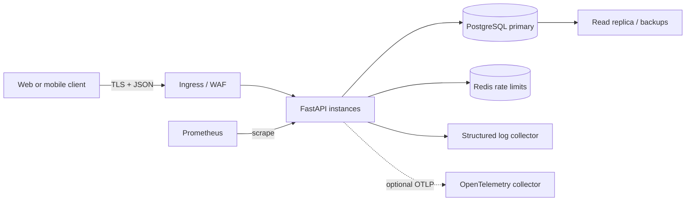
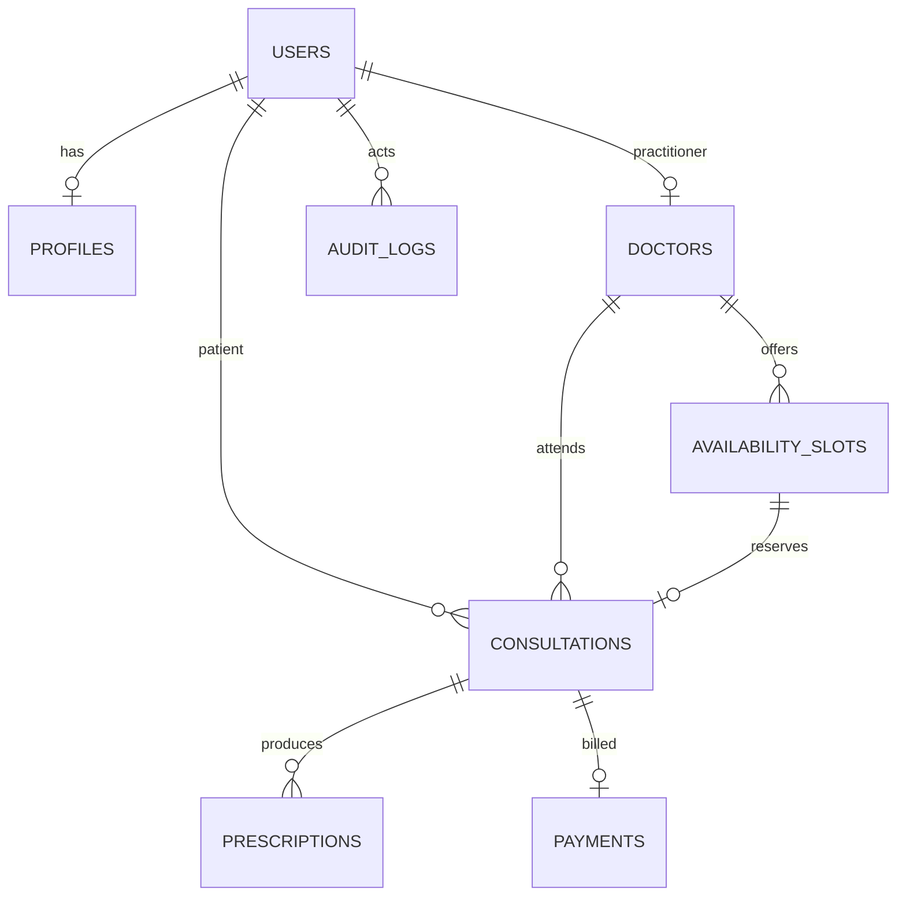

# Architecture and design

## Overview

The service is a modular FastAPI application backed by PostgreSQL. Clients authenticate using short-lived signed bearer tokens. HTTP handlers validate requests, enforce role and ownership checks, and use SQLAlchemy transactions to persist domain changes. Redis provides a shared per-client rate counter. Prometheus scrapes request counts and latency histograms. Logs include request IDs, method, path, status and duration; sensitive request bodies and credentials are never logged.



The application is intentionally a modular monolith. At the assignment target of 100k daily consultations (about 1.2 consultations/second averaged over a day), horizontally scaled stateless API instances and indexed relational queries are an appropriate initial design. Peak traffic and hot-spot load must be load-tested; scale workers independently before extracting services. Avoid distributing booking across services until operational evidence justifies the added consistency costs.

## Core data and relationships

`users` owns authentication and role state. Optional `profiles` store patient preferences. `doctors` links one user to directory data. A doctor owns many `availability_slots`; a slot can be consumed by only one `consultations` row. A consultation links one patient, one doctor, and one slot. Prescriptions belong to a completed consultation. Payments are one-per-consultation and keep only provider references and minor-unit amounts. `audit_logs` record actor, action, resource, request address and minimal metadata. `idempotency_records` map a user-scoped request key to its committed resource.



IDs are UUID strings. Foreign keys enforce referential integrity. Doctor, patient, time, and status columns have indexes for primary query paths. PostgreSQL uses row-level locking (`SELECT ... FOR UPDATE`) during booking, and the unique consultation slot constraint is the final concurrency guard. Booking and its idempotency record commit in one transaction.

## Booking sequence and concurrency

```mermaid
sequenceDiagram
  actor P as Patient
  participant A as API
  participant D as PostgreSQL
  P->>A: POST /v1/consultations + Idempotency-Key
  A->>A: Validate token, role, input and rate
  A->>D: Begin; lookup (user,key)
  alt replay
    D-->>A: Existing consultation
  else new booking
    A->>D: Lock available slot FOR UPDATE
    D-->>A: Slot or unavailable
    A->>D: Mark booked; insert consultation + idempotency + audit
    A->>D: Commit
  end
  A-->>P: Consultation response
```

Clients must reuse the same key for retries of one booking and generate a new key for a new intent. Exponential backoff with full jitter is recommended for transient 429/5xx responses (for example 200ms, 400ms, 800ms capped at 5 seconds, with random jitter); honor `Retry-After`. Do not automatically retry non-idempotent operations without their idempotency key. A collision on the same slot is a 409 and must be resolved by fetching availability.

## Lifecycle, transactions, and async work

Consultation transitions are `booked → confirmed → in_progress → completed`; booked or confirmed consultations may be cancelled. Cancellation frees the availability slot within the same transaction. Only the treating doctor or admin may set notes and prescribe; patients may cancel their own appointment. Prescriptions require a completed consultation. Domain changes write identifier-only events to a transactional outbox in the same transaction. `app.worker` consumes pending events with row locks, bounded exponential retry delay, and event IDs available as downstream idempotency keys. The included dispatcher logs consumption; actual notification and payment-provider adapters remain deployment integrations. This keeps slow side effects outside API request latency without losing the trigger when a domain transaction commits.

Do not use distributed two-phase commit for a future payment integration. Model payment as an explicit saga: reserve the slot and create a pending payment intent in one local transaction; request provider authorization idempotently from an outbox consumer; on success mark payment authorized and consultation confirmed; on terminal failure cancel the consultation and release the slot as a compensating transaction. If a later cancellation follows capture, issue an idempotent refund and track refund-pending state until the provider confirms. Reconciliation jobs compare local pending records with provider status after outages.

## Scale, partitions, cache, and recovery

Use connection pooling with conservative pool limits and PgBouncer at higher concurrency. Add read replicas for read-heavy directory and analytics traffic only after measuring lag and stale-read tolerance. Search uses bounded pagination and indexes; consider PostgreSQL full-text indexes before introducing a dedicated search engine. Cache public verified doctor metadata with short TTL and explicit invalidation after profile edits; booking availability should be read from PostgreSQL and never trusted from cache at write time. This implementation does not yet cache directory responses.

At larger data volume, partition append-heavy `audit_logs` by month on `created_at`, retaining partitions according to the legal retention schedule. Consultations can be range-partitioned by creation month only if query patterns and foreign-key behavior are designed together; the current schema is unpartitioned. Use encrypted daily full backups plus continuous WAL archiving to a separate account/region, target an initial RPO ≤5 minutes and RTO ≤1 hour, and run quarterly restore drills. These are deployment targets and require a managed database setup.

## API and deployment

REST endpoints are documented through the generated OpenAPI 3 schema at `/openapi.json` and the committed `openapi.json` snapshot. Deploy the same immutable container image to multiple stateless instances behind a TLS-terminating ingress. Configure readiness/liveness probes, rolling deploys, database migrations as a release job, autoscaling from CPU/latency, and a rollback path. See [operations.md](operations.md) for environment and SLO notes.
